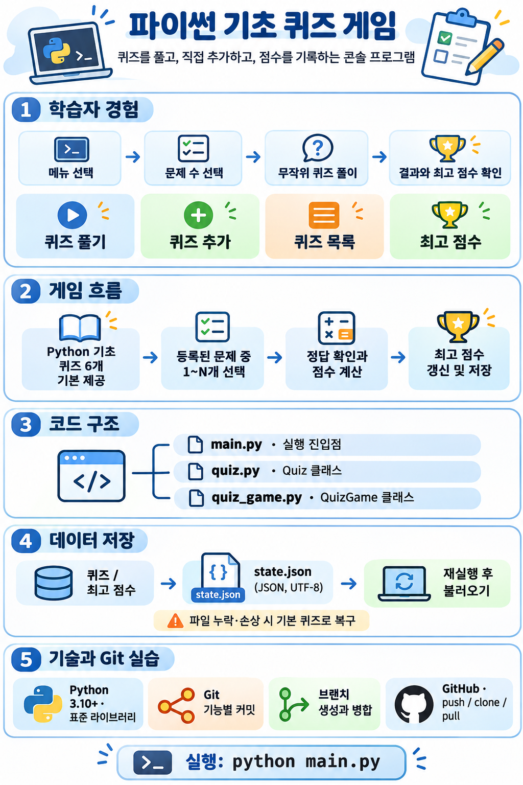
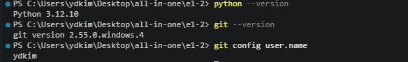
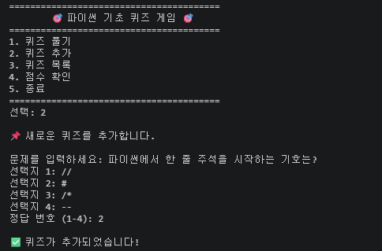
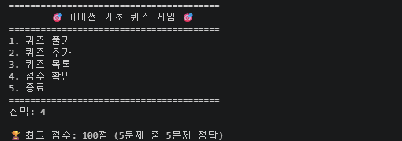
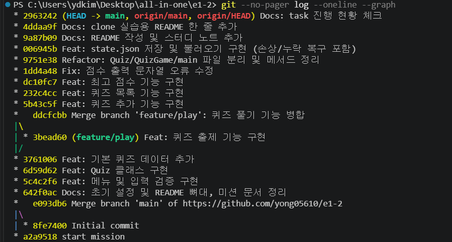

# 제출 보고서: 파이썬 기초 퀴즈 게임



## 1. 제출 정보
| 항목 | 내용 |
|---|---|
| GitHub 저장소 | https://github.com/yong05610/e1-2 |
| 주제 | 파이썬 기초 퀴즈 |
| 실행 | `python main.py` (Python 3.12.10, 외부 라이브러리 없음) |

## 2. 개발 환경
| 항목 | 확인 명령 | 결과 |
|---|---|---|
| Python | `python --version` | Python 3.12.10 (3.10 이상 요구 충족) |
| Git | `git --version` | git version 2.55.0.windows.4 |
| 에디터 | VS Code (PowerShell 터미널) | |
| Git 설정 | `git config user.name` / `user.email` | 설정됨 |

> 스크린샷: `docs/screenshots/env.png` (VS Code + 위 3개 명령 실행 화면)

## 3. 미션 요구사항 충족 현황

### 3.1 동작하는 퀴즈 게임
| 요구사항 | 충족 | 근거 |
|---|---|---|
| 메뉴에서 번호 선택 (풀기/추가/목록/점수/종료) | O | `QuizGame.show_menu`, `handle_choice` |
| 퀴즈 5개 이상 (본인 주제) | O | 기본 퀴즈 6개 (`default_quizzes`) |
| 종료 후 재실행해도 퀴즈/최고 점수 유지 | O | `state.json` 저장/불러오기 |
| 잘못된 입력 처리 | O | `read_int`: 공백 제거, 숫자 아님, 범위 밖, 빈 입력 |
| Ctrl+C / EOFError 안전 종료 | O | `run()`의 `try/except/finally` |
| 파일 없음/손상 시 실행 가능 | O | `load_state()`: 없음 → 기본 퀴즈, 손상 → 안내 후 초기화 |

### 3.2 코드 구조
| 요구사항 | 충족 | 근거 |
|---|---|---|
| 클래스 2개 이상 | O | `Quiz` (quiz.py), `QuizGame` (quiz_game.py) |
| 기능별 메서드 분리 | O | 입력(`read_int`, `read_text`) / 진행(`play_quiz`) / 저장(`save_state`, `load_state`) |
| `state.json` UTF-8 저장 | O | `open(..., encoding="utf-8")`, `ensure_ascii=False` |

### 3.3 GitHub 저장소
| 요구사항 | 충족 | 근거 |
|---|---|---|
| 코드가 GitHub에 업로드 | O | origin/main 과 로컬 main 일치 |
| 의미 있는 커밋 10개 이상 | O | 총 23개 (`git rev-list --count HEAD`) |
| 브랜치 생성 및 병합 | O | `feature/play`, `feature/random`, `feature/count` 생성 → 각각 `main`에 병합 (병합 커밋 `ddcfcbb`, `55a3443`, `9cf7e04`) |
| clone, pull 각 1회 이상 | O | 아래 4장 참조 |
| README 필수 항목 | O | 개요, 선정 이유, 실행 방법, 기능 목록, 파일 구조, 데이터 파일 설명 |

## 4. Git 명령 7종 사용 증거
| 명령 | 사용 증거 |
|---|---|
| `git init` | `git reflog`의 첫 기록 `commit (initial): start mission` (a2a9518) |
| `git add` | 모든 커밋 전에 사용 |
| `git commit` | 커밋 23개, `Feat:`/`Fix:`/`Docs:`/`Refactor:` 형식 |
| `git push` | `git push origin main`으로 GitHub에 반영 |
| `git pull` | ① `pull origin main --allow-unrelated-histories` (원격 초기 커밋과 병합, e093db6) ② clone 실습 후 `git pull` (Fast-forward, 4ddaa9f 반영) |
| `git checkout` | `git checkout -b feature/play` → `git checkout main` |
| `git clone` | `e1-2-clone` 폴더에 복제 (`git reflog`: `clone: from https://github.com/yong05610/e1-2.git`) |

### clone/pull 실습 기록
1. `git clone https://github.com/yong05610/e1-2.git` → 별도 폴더 `e1-2-clone`
2. 복제본 README에 한 줄 추가 → `commit` → `push` (4ddaa9f `Docs: clone 실습용 README 한 줄 추가`)
3. 기존 작업 폴더에서 `git pull` (`There is no tracking information` 오류 → `git branch --set-upstream-to=origin/main main` 후 재실행, Fast-forward)
4. `git log`와 README에서 변경 반영 확인

### 브랜치 병합 기록 (`git log --oneline --graph` 일부)
```
*   ddcfcbb Merge branch 'feature/play': 퀴즈 풀기 기능 병합
|\
| * 3bead60 Feat: 퀴즈 출제 기능 구현
|/
* 3761006 Feat: 기본 퀴즈 데이터 추가
```

## 5. 커밋 이력 (기능 단위)
| 단계 | 커밋 |
|---|---|
| 초기 설정 | `Docs: 초기 설정 및 README 뼈대, 미션 문서 정리` |
| 메뉴 | `Feat: 메뉴 및 입력 검증 구현` |
| Quiz 클래스 | `Feat: Quiz 클래스 구현` |
| 기본 퀴즈 | `Feat: 기본 퀴즈 데이터 추가` |
| 퀴즈 풀기 (브랜치) | `Feat: 퀴즈 출제 기능 구현` + 병합 커밋 |
| 퀴즈 추가 | `Feat: 퀴즈 추가 기능 구현` |
| 퀴즈 목록 | `Feat: 퀴즈 목록 기능 구현` |
| 점수 | `Feat: 최고 점수 기능 구현`, `Fix: 점수 출력 문자열 오류 수정` |
| 구조 정리 | `Refactor: Quiz/QuizGame/main 파일 분리 및 메서드 정리` |
| 저장 | `Feat: state.json 저장 및 불러오기 구현 (손상/누락 복구 포함)` |
| README | `Docs: README 작성` (9a87b09) |
| 보너스: 랜덤 출제 (브랜치) | `Feat: 퀴즈 랜덤 출제 구현 (random.shuffle)` + 병합 커밋 |
| 보너스: 문제 수 선택 (브랜치) | `Feat: 풀 문제 수 선택 기능 구현` + 병합 커밋 |
| 제출물 정리 | `Docs: 제출 보고서, 스크린샷, README 갱신` |

### 보너스 기능 (선택 과제 중 2개 구현)
| 기능 | 구현 | 검증 |
|---|---|---|
| 랜덤 출제 | `play_quiz`에서 퀴즈 목록을 복사해 `random.shuffle`로 섞어 출제 (원본 목록 순서는 유지) | 5회 실행 시 모두 다른 순서, 전체 문제가 한 번씩만 출제 |
| 문제 수 선택 | 풀기 시작 시 `read_int`로 1 ~ 전체 문제 수를 입력받아 섞은 목록의 앞에서 N개 사용 | 3, 전체, 1 입력 확인 / `abc`, 빈 입력, 0, 범위 초과는 재입력 / 결과는 선택한 문제 수 기준 |

## 6. 실행 결과
실제 실행 화면은 7장의 스크린샷을 참고합니다. 요약은 다음과 같습니다.
```
📂 저장된 데이터를 불러왔습니다. (퀴즈 11개, 최고점수 83점)
선택: 2  →  ✅ 퀴즈가 추가되었습니다!   (퀴즈 12개)
선택: 1  →  풀 문제 수 (1-11): 5  →  📝 퀴즈를 시작합니다! (총 5문제)
선택: 4  →  🏆 최고 점수: 100점 (5문제 중 5문제 정답)
```
재실행해도 추가한 퀴즈와 최고 점수가 `state.json`에서 그대로 불러와집니다.

### 입력 오류 처리 확인
| 입력 | 결과 |
|---|---|
| `abc` | `⚠️ 잘못된 입력입니다. 1-5 사이의 숫자를 입력하세요.` |
| `9` | `⚠️ 범위를 벗어났습니다. 1-5 사이의 숫자를 입력하세요.` |
| (빈 Enter) | `⚠️ 입력이 비어 있습니다. 1-5 사이의 숫자를 입력하세요.` |
| ` 1 ` (공백 포함) | 공백 제거 후 1번으로 처리 |
| Ctrl+C / 입력 종료 | `⚠️ 입력이 중단되었습니다. 저장 후 안전하게 종료합니다.` |
| `state.json` 손상 | `⚠️ 데이터 파일이 손상되어 기본 퀴즈로 초기화합니다.` |

## 7. 스크린샷 (`docs/screenshots/`)
| 파일 | 내용 | 이미지 |
|---|---|---|
| `env.png` | Python 3.12.10, git 2.55.0, `git config user.name` |  |
| `menu.png` | 실행 직후 메뉴 화면 |  |
| `add_quiz.png` | 2번 퀴즈 추가 입력 과정과 `✅ 퀴즈가 추가되었습니다!` |  |
| `list.png` | 3번 퀴즈 목록 |  |
| `play.png` | 1번 퀴즈 풀기 (풀 문제 수 선택 후 무작위 출제) |  |
| `score.png` | 4번 점수 확인 |  |
| `git_graph.png` | `git log --oneline --graph` (브랜치 병합 기록) |  |

> `git_graph.png`는 보너스 브랜치 병합 직전의 그래프입니다. 최종 이력은 `git log --oneline --graph`로 확인할 수 있습니다.

## 8. 학습 목표 정리 (과제 목표 15개 항목)
과제 목표 3번의 15개 항목을 한 줄로 정리하고, 이 프로젝트의 어느 코드에서 사용했는지 연결했습니다.

### Python 기초
| # | 항목 | 설명 | 이 프로젝트의 예 |
|---|---|---|---|
| 1 | 변수가 무엇이고 왜 사용하는가 | 값에 이름을 붙여 저장해 두고, 여러 곳에서 다시 쓰고 나중에 바꾸기 위해 사용한다. | `correct = 0` (정답 수 집계), `self.best_score` (최고 점수) |
| 2 | int, str, bool, list, dict의 차이 | `int` 정수, `str` 문자열, `bool` 참/거짓, `list` 순서가 있는 목록(번호로 접근, 0부터), `dict` 키-값 쌍(키로 접근). | `score`(int), `question`(str), `is_correct()`의 반환값(bool), `choices`·`quizzes`(list), `to_dict()`·`state.json`(dict) |
| 3 | if / elif / else | 조건에 따라 실행할 코드를 나눈다. 위에서부터 검사해 처음 참인 한 곳만 실행한다. | `handle_choice`의 메뉴 분기, `update_best_score`의 최고 점수 비교 |
| 4 | for와 while의 차이 | `for`는 대상이 정해진 반복(목록 순회), `while`은 조건이 참인 동안 반복(끝을 모를 때). | `for quiz in order` (출제), `while self.running` (메뉴 반복), `read_int`의 `while True` (올바른 입력이 올 때까지) |
| 5 | 함수의 매개변수와 반환값 | 매개변수는 함수가 받는 입력, 반환값은 `return`으로 돌려주는 결과. | `read_int(prompt, low, high)` → 검증된 정수 반환, `is_correct(user_answer)` → `True`/`False` 반환 |

### 클래스와 객체
| # | 항목 | 설명 | 이 프로젝트의 예 |
|---|---|---|---|
| 6 | 클래스가 무엇이고 왜 사용하는가 | 관련된 데이터와 동작을 하나로 묶은 설계도. **추상화**(역할별로 나누어 필요한 것만 다룸)와 **재사용성**(같은 설계로 객체를 여러 개 생성)을 위해 사용한다. | `Quiz`는 문제 1개의 데이터와 동작(출력, 채점, 변환)을 묶어 퀴즈 하나하나를 같은 방식으로 만들고, `QuizGame`은 목록·점수·흐름·저장을 한 곳에서 관리해 역할을 분리 |
| 7 | `__init__`과 `self`의 역할 | `__init__`은 객체를 만들 때 자동 호출되어 속성의 초기값을 정하는 생성자. `self`는 메서드를 호출한 그 객체 자신. | `Quiz("문제", [...], 2)` 호출 시 `__init__`이 실행되어 `self.question = question` 저장 |
| 8 | 속성과 메서드의 정의와 활용 | 속성은 객체가 가진 데이터, 메서드는 객체가 하는 동작(클래스 안의 `def`). | 속성: `question`, `choices`, `answer`, `quizzes`, `best_score` / 메서드: `display()`, `is_correct()`, `play_quiz()`, `save_state()` |

### 파일 입출력
| # | 항목 | 설명 | 이 프로젝트의 예 |
|---|---|---|---|
| 9 | 파일을 열고 읽고 쓰는 기본 과정 | 열기 → 읽기/쓰기 → 닫기. `with`를 쓰면 블록이 끝날 때 자동으로 닫힌다. `"r"` 읽기, `"w"` 쓰기(기존 내용 삭제). | `load_state()` (`"r"`), `save_state()` (`"w"`), 둘 다 `encoding="utf-8"` |
| 10 | JSON이란 무엇이고 왜 저장에 사용하는가 | 키-값과 배열로 데이터를 적는 텍스트 형식. 사람이 읽을 수 있고 dict/list와 쉽게 변환되며, 프로그램을 종료해도 데이터가 유지된다. | `state.json`에 퀴즈 목록과 최고 점수 저장 (`json.dump` / `json.load`) |
| 11 | try / except로 오류 처리 | 오류가 나도 프로그램이 비정상 종료하지 않고 안내하거나 복구하도록 처리한다. | `int(text)`의 `ValueError`, 손상된 `state.json`의 `JSONDecodeError`, Ctrl+C·입력 종료(`KeyboardInterrupt`, `EOFError`) |

### Git 기초
| # | 항목 | 설명 | 이 프로젝트의 예 |
|---|---|---|---|
| 12 | Git이 무엇이고 왜 필요한가 | 변경 이력을 기록하는 분산 버전 관리 도구. 이전 상태 복구, 변경 추적, 브랜치를 이용한 안전한 개발, 협업을 위해 필요하다. | 기능 단위 커밋 20개 이상으로 개발 과정을 기록 |
| 13 | init, add, commit, push, pull, checkout, clone의 역할 | `init` 저장소 생성 / `add` 커밋 대기 영역에 올림 / `commit` 로컬 이력으로 저장 / `push` 원격에 업로드 / `pull` 원격 변경을 가져와 병합 / `checkout` 브랜치 이동 / `clone` 원격 저장소를 복제 | 4장의 "Git 명령 7종 사용 증거" 표 참조 |
| 14 | 브랜치를 생성하고 병합 | `git checkout -b 이름`으로 브랜치를 만들어 독립적으로 작업한 뒤, `main`에서 `git merge 이름`으로 합친다. | `feature/play`, `feature/random`, `feature/count`를 만들어 각각 `main`에 병합 |
| 15 | 원격 저장소를 clone하고 pull로 변경 가져오기 | `clone`으로 복제한 폴더에서 수정·push한 뒤, 원래 폴더에서 `pull`로 가져와 반영을 확인한다. | `e1-2-clone`에서 README 수정 후 push → 원래 폴더에서 `git pull` (Fast-forward) |
